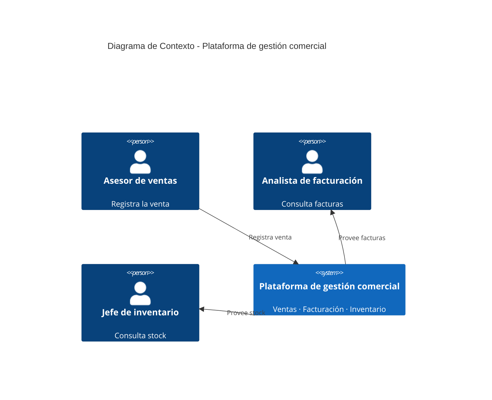

# Diagrama de Contexto C4 — Plataforma de gestión comercial

## Enunciado

A partir del ejemplo de microservicios (Ventas, Facturación e Inventario
comunicados vía RabbitMQ), elabore el **Diagrama de Contexto C4** de la
plataforma. Identifique quién interactúa con el sistema desde el exterior
(actores/roles humanos) y qué hace cada uno, sin entrar todavía en el
detalle de los microservicios internos ni de la tecnología usada (eso
corresponde a los niveles de Contenedor y Componente).

## Diagrama

## Nota pedagógica

A este nivel, a propósito, no se ve RabbitMQ ni los tres microservicios
por separado — el Contexto C4 trata el sistema como una **caja negra
única**. Los detalles internos (Ventas / Facturación / Inventario /
RabbitMQ) aparecen recién en el **Diagrama de Contenedores**, el
siguiente nivel de C4.