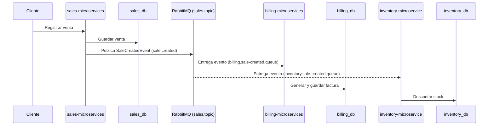

# Arquitectura — Sales Microservices

## 1. Visión general

El sistema está compuesto por tres microservicios independientes, cada
uno con su propia base de datos (patrón **Database per Service**), que
se comunican de forma **asíncrona** a través de RabbitMQ usando un
exchange tipo `topic`. Ningún servicio llama directamente a otro: la
única forma de comunicación entre ellos es publicar y consumir eventos.

| Servicio | Responsabilidad | Base de datos |
|---|---|---|
| `sales-microservices` | Registrar la venta y publicar el evento | `sales_db` |
| `billing-microservices` | Generar la factura a partir de la venta | `billing_db` |
| `inventory-microservice` | Descontar el stock del producto vendido | `inventory_db` |

## 2. Patrón de comunicación

- **Estilo**: Event-Driven Architecture (pub/sub)
- **Broker**: RabbitMQ
- **Exchange**: `sales.topic` (tipo `topic`, durable)
- **Routing key del evento**: `sale.created`

`billing-microservices` e `inventory-microservice` no se conocen entre
sí ni conocen los detalles internos de `sales-microservices`; solo
saben que existe un exchange `sales.topic` y un contrato de evento
(`SaleCreatedEvent`) al que se suscriben.

### Colas y bindings

| Cola | Servicio consumidor | Routing key (binding) |
|---|---|---|
| `billing.sale-created.queue` | `billing-microservices` | `sale.created` |
| `inventory.sale-created.queue` | `inventory-microservice` | `sale.created` |

Usar `topic` (en vez de `fanout`) desde el inicio permite, a futuro,
agregar más tipos de eventos (`sale.cancelled`, `sale.refunded`) sin
tener que crear un exchange nuevo — solo se agregan nuevos bindings o
se usan patrones como `sale.#`.

## 3. Contrato del evento — `SaleCreatedEvent`

```json
{
  "eventId": "b3f1c2a0-6e2a-4e2a-9b3a-2f1e5b2a9c11",
  "eventType": "sale.created",
  "occurredAt": "2026-09-09T14:32:00Z",
  "saleId": "S-00123",
  "customerId": "C-4521",
  "items": [
    { "productId": "P-9001", "quantity": 2, "unitPrice": 45000 }
  ],
  "totalAmount": 90000
}
```

- `eventId`: identificador único del evento (permite detectar
  duplicados — ver sección 5).
- `saleId`: identificador de la venta en `sales_db`, referencia que
  usarán `billing_db` e `inventory_db` para correlacionar sus propios
  registros con la venta original.

## 4. Flujo end-to-end

1. Un cliente/asesor realiza una venta a través de `sales-microservices`.
2. `sales-microservices` guarda la venta en `sales_db` (transacción
   local, sin tocar ninguna otra base de datos).
3. Una vez confirmada la transacción, `sales-microservices` publica un
   `SaleCreatedEvent` en el exchange `sales.topic` con routing key
   `sale.created`.
4. RabbitMQ enruta una copia del mensaje a cada cola enlazada:
   `billing.sale-created.queue` e `inventory.sale-created.queue`.
5. `billing-microservices` consume el mensaje de su cola, genera la
   factura y la guarda en `billing_db`.
6. `inventory-microservice` consume el mensaje de su cola (en
   paralelo, sin depender de billing), descuenta el stock de cada
   producto vendido y lo guarda en `inventory_db`.
7. Si algún consumidor falla al procesar el mensaje, este vuelve a la
   cola (o a una dead-letter queue) para reintento — `sales-microservices`
   no se entera ni le afecta.



## 5. Consideraciones de diseño

- **Idempotencia**: como RabbitMQ garantiza *at-least-once delivery*,
  un mensaje puede llegar duplicado. Cada consumidor debe validar
  `eventId` antes de procesar, para no generar dos facturas o
  descontar el stock dos veces.
- **Desacoplamiento de datos**: `billing-microservices` e
  `inventory-microservice` **no leen** directamente `sales_db`; toda
  la información que necesitan viaja dentro del evento o se consulta
  después vía API si hiciera falta un dato adicional.
- **Fallos aislados**: si `billing-microservices` está caído,
  `inventory-microservice` igual procesa su parte — no hay
  dependencia entre ellos, solo con el evento.
- **Orden de consumo**: no hay garantía de que `billing` procese antes
  que `inventory` o viceversa; el diseño no debe asumir ningún orden
  entre ambos.