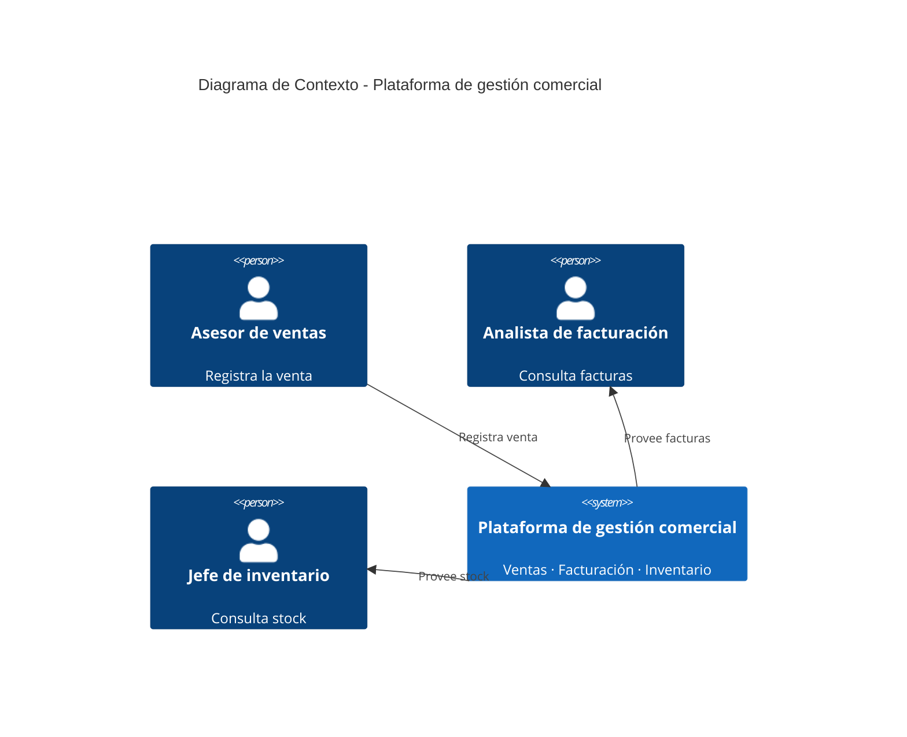
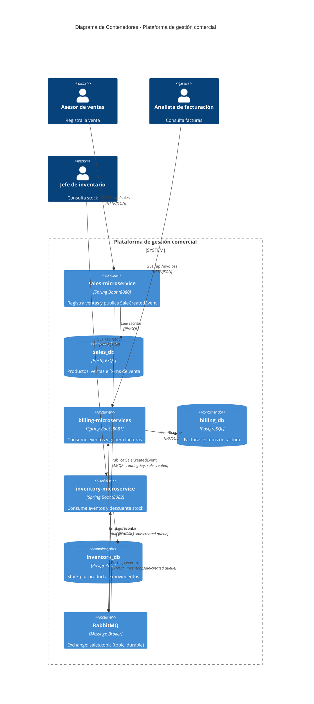
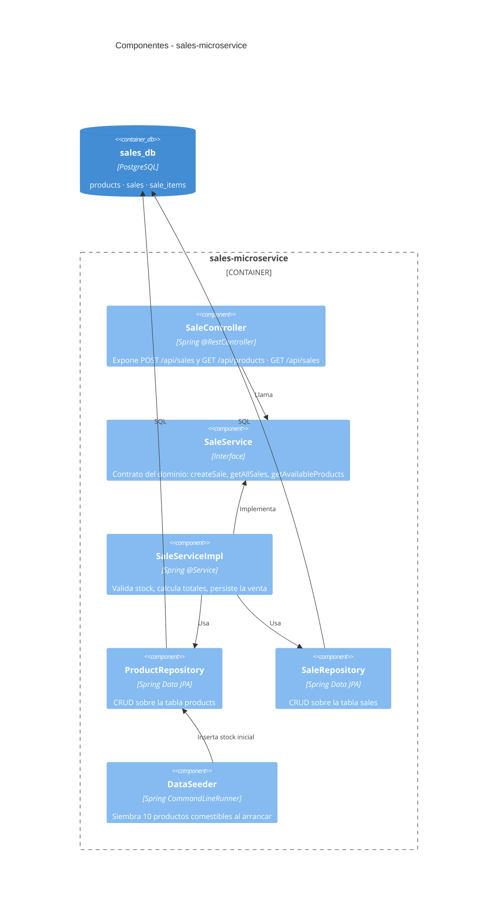
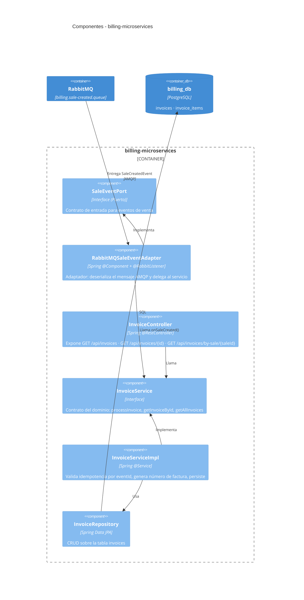
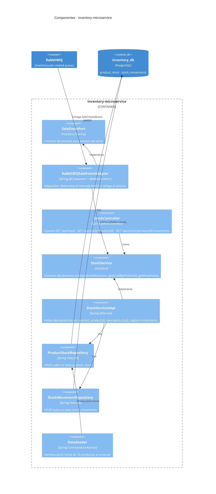
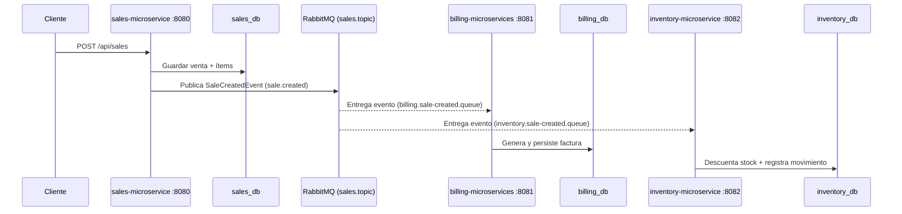

# Plataforma de Gestión Comercial — Demo de Microservicios

Demo educativo de arquitectura de microservicios con comunicación asíncrona vía RabbitMQ.
Implementa el patrón **Database per Service**, **Event-Driven Architecture** y **Adapter Pattern**.

---

## Stack tecnológico

| Capa | Tecnología |
|---|---|
| Lenguaje | Java 21 |
| Framework | Spring Boot 4.1.1 |
| Persistencia | Spring Data JPA + PostgreSQL |
| Mensajería | RabbitMQ (AMQP) |
| Documentación API | SpringDoc OpenAPI (Swagger UI) |
| Build | Maven |

---

## Microservicios

| Servicio | Puerto | Base de datos | Rol |
|---|---|---|---|
| `sales-microservice` | 8080 | `sales_db` | Registra ventas y publica eventos |
| `billing-microservices` | 8081 | `billing_db` | Genera facturas a partir de eventos |
| `inventory-microservice` | 8082 | `inventory_db` | Descuenta stock a partir de eventos |

Cada servicio tiene su **propia base de datos** — ninguno accede directamente a la DB del otro.

---

## Diagramas C4

### Nivel 1 — Contexto

Muestra quién interactúa con el sistema desde el exterior, tratando la plataforma como una caja negra única.



> A este nivel no se ve RabbitMQ ni los microservicios por separado. El Contexto C4 trata el sistema como una **caja negra única**.

---

### Nivel 2 — Contenedores

Abre la caja negra y muestra los procesos/aplicaciones que la componen y cómo se comunican.



---

### Nivel 3 — Componentes

Abre cada contenedor y muestra su arquitectura interna en capas.

#### sales-microservice



#### billing-microservices



#### inventory-microservice



---

## Patrón Adapter en los consumidores

`billing-microservices` e `inventory-microservice` usan el patrón **Adapter** para desacoplar el dominio del transporte de mensajes:

```
RabbitMQ (cola)
      │
      ▼
RabbitMQSaleEventAdapter   ──implements──▶   SaleEventPort (interfaz/puerto)
  @RabbitListener                              (el dominio solo conoce el puerto)
      │
      ▼
InvoiceService / StockService
      │
      ▼
   PostgreSQL
```

Si en el futuro se reemplaza RabbitMQ por Kafka, solo cambia el adaptador — el dominio no se toca.

---

## Contrato del evento — `SaleCreatedEvent`

Publicado por `sales-microservice` en el exchange `sales.topic` con routing key `sale.created`:

```json
{
  "eventId": "b3f1c2a0-6e2a-4e2a-9b3a-2f1e5b2a9c11",
  "eventType": "sale.created",
  "occurredAt": "2026-09-09T14:32:00Z",
  "saleId": "S-00123",
  "customerId": "C-4521",
  "items": [
    { "productId": "1", "quantity": 2, "unitPrice": 45000 }
  ],
  "totalAmount": 90000
}
```

- **`eventId`**: clave de idempotencia — ambos consumidores la verifican antes de procesar para evitar duplicados (RabbitMQ garantiza *at-least-once delivery*).
- **`saleId`**: correlaciona los registros de `billing_db` e `inventory_db` con la venta original en `sales_db`.

---

## Flujo end-to-end



`billing` e `inventory` procesan en paralelo e independiente — si uno falla, el otro no se ve afectado.

---

## Estructura del proyecto

```
microservices-example/
├── sales-microservice/          # Puerto 8080
│   ├── src/main/java/.../
│   │   ├── controller/          # SaleController
│   │   ├── service/             # SaleService (interfaz) + impl/
│   │   ├── repository/          # ProductRepository, SaleRepository
│   │   ├── domain/
│   │   │   ├── entity/          # Product, Sale, SaleItem
│   │   │   └── dto/             # CreateSaleRequest, SaleResponse, ...
│   │   └── config/              # DataSeeder, GlobalExceptionHandler
│   ├── database/
│   │   ├── schema.sql           # DDL de referencia
│   │   └── seed.sql             # Datos de ejemplo
│   └── .env                     # Variables locales (no commiteado)
│
├── billing-microservices/       # Puerto 8081
│   ├── src/main/java/.../
│   │   ├── adapter/             # SaleEventPort + RabbitMQSaleEventAdapter
│   │   ├── controller/          # InvoiceController
│   │   ├── service/             # InvoiceService (interfaz) + impl/
│   │   ├── repository/          # InvoiceRepository
│   │   ├── domain/
│   │   │   ├── entity/          # Invoice, InvoiceItem
│   │   │   └── dto/             # SaleCreatedEvent, InvoiceResponse, ...
│   │   └── config/              # RabbitMQConfig, GlobalExceptionHandler
│   ├── database/
│   │   ├── schema.sql
│   │   └── seed.sql
│   └── .env
│
├── inventory-microservice/      # Puerto 8082
│   ├── src/main/java/.../
│   │   ├── adapter/             # SaleEventPort + RabbitMQSaleEventAdapter
│   │   ├── controller/          # StockController
│   │   ├── service/             # StockService (interfaz) + impl/
│   │   ├── repository/          # ProductStockRepository, StockMovementRepository
│   │   ├── domain/
│   │   │   ├── entity/          # ProductStock, StockMovement
│   │   │   └── dto/             # SaleCreatedEvent, ProductStockResponse, ...
│   │   └── config/              # RabbitMQConfig, DataSeeder, GlobalExceptionHandler
│   ├── database/
│   │   ├── schema.sql
│   │   └── seed.sql
│   └── .env
│
├── 1. Enunciado.md
├── 2. Documentation.md
├── 3. InstalacionRabbitMQ.md
└── 4. Execucion.md
```

---

## Ejecución rápida

Ver [4. Execucion.md](./4.%20Execucion.md) para instrucciones detalladas.

```bash
# 1. Configurar cada servicio
cp sales-microservice/.env.example     sales-microservice/.env
cp billing-microservices/.env.example  billing-microservices/.env
cp inventory-microservice/.env.example inventory-microservice/.env
# Editar cada .env con las credenciales reales

# 2. Crear bases de datos en PostgreSQL
psql -U postgres -c "CREATE DATABASE sales_db;"
psql -U postgres -c "CREATE DATABASE billing_db;"
psql -U postgres -c "CREATE DATABASE inventory_db;"

# 3. Arrancar cada servicio (en terminales separadas)
cd sales-microservice     && ./mvnw spring-boot:run
cd billing-microservices  && ./mvnw spring-boot:run
cd inventory-microservice && ./mvnw spring-boot:run
```

---

## Endpoints disponibles

### sales-microservice — http://localhost:8080

| Método | URL | Descripción |
|---|---|---|
| `GET` | `/api/products` | Listar productos con stock disponible |
| `GET` | `/api/sales` | Listar todas las ventas |
| `GET` | `/api/sales/{id}` | Obtener venta por ID |
| `POST` | `/api/sales` | **Registrar una venta** |

### billing-microservices — http://localhost:8081

| Método | URL | Descripción |
|---|---|---|
| `GET` | `/api/invoices` | Listar todas las facturas |
| `GET` | `/api/invoices/{id}` | Obtener factura por ID |
| `GET` | `/api/invoices/by-sale/{saleId}` | Factura por ID de venta |

### inventory-microservice — http://localhost:8082

| Método | URL | Descripción |
|---|---|---|
| `GET` | `/api/stock` | Stock actual de todos los productos |
| `GET` | `/api/stock/{productId}` | Stock de un producto |
| `GET` | `/api/stock/{productId}/movements` | Historial de movimientos |
| `GET` | `/api/stock/by-sale/{saleId}` | Movimientos generados por una venta |

Swagger UI disponible en `/swagger-ui.html` de cada servicio.

---

## Consideraciones de diseño

| Principio | Implementación |
|---|---|
| **Database per Service** | Cada microservicio tiene su propia DB — ninguno accede a la DB del otro |
| **Event-Driven** | La comunicación entre servicios es solo a través de eventos en RabbitMQ |
| **Idempotencia** | `billing` verifica `eventId` único · `inventory` verifica `(eventId, productId)` |
| **Desacoplamiento** | El Adapter Pattern aísla el dominio del transporte de mensajes |
| **Fallos aislados** | Si `billing` cae, `inventory` sigue procesando su cola y viceversa |
| **Arquitectura en capas** | `controller → service (interfaz) → impl → repository → entity` |
