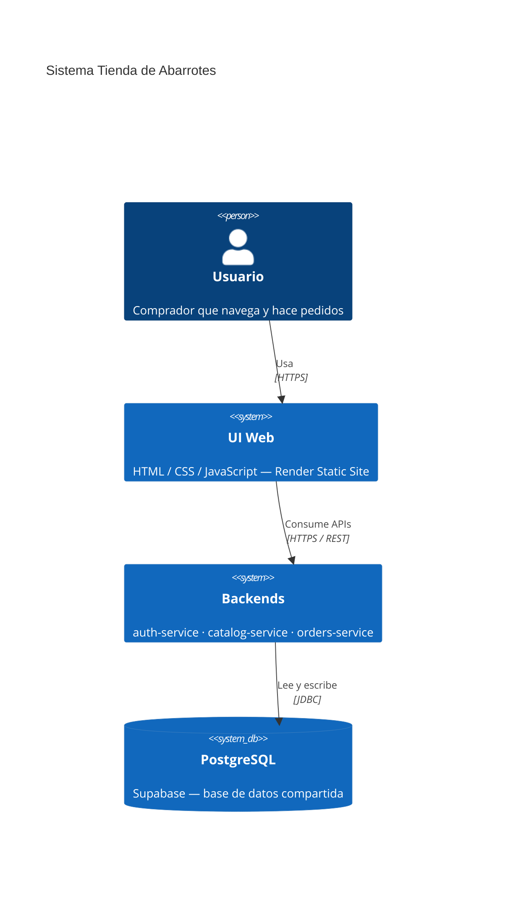
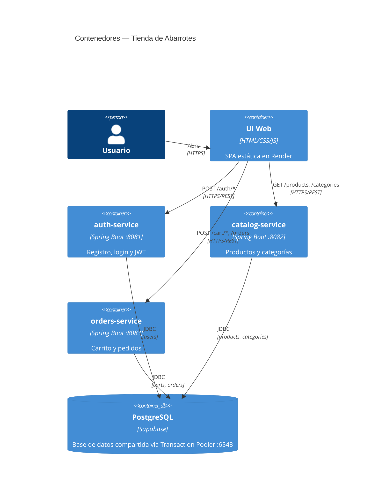
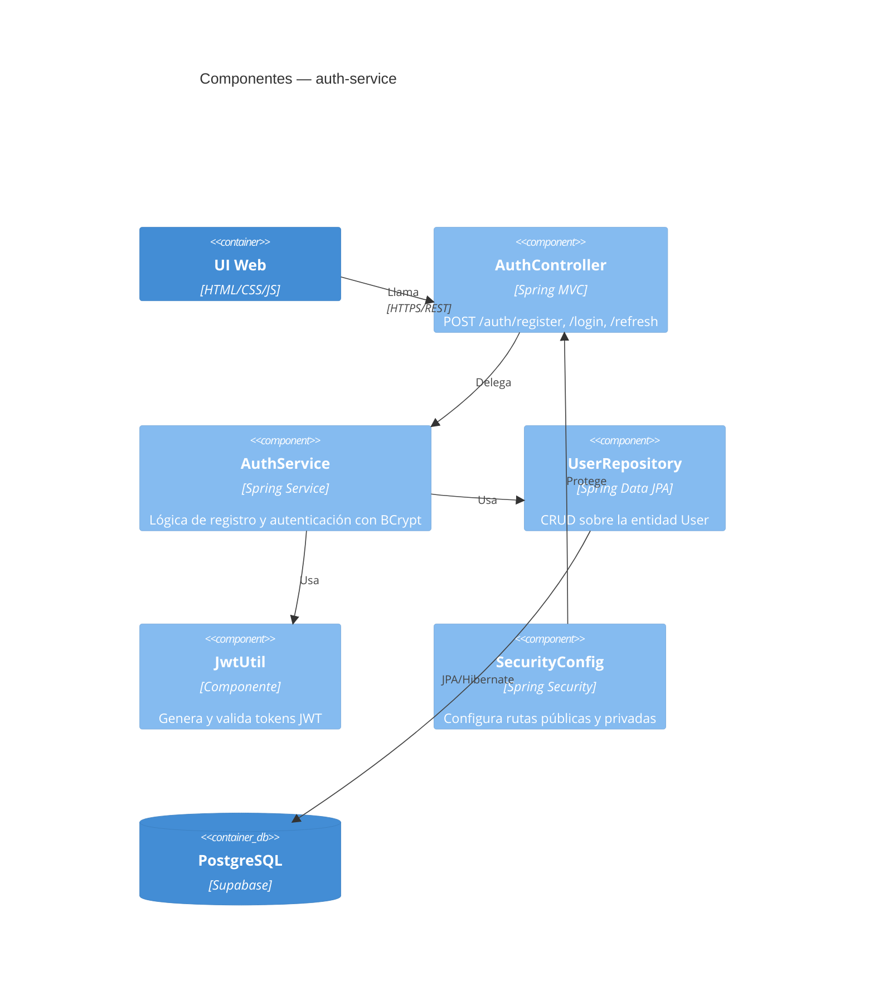

# Tienda de Abarrotes — Mono Repo

3 WebAPIs independientes en Spring Boot, compartiendo la misma base de datos PostgreSQL en Supabase, con una UI en HTML/CSS/Bootstrap/JS que consume los 3 servicios.

---

## Diagramas C4

### Nivel 1 — Contexto del Sistema



### Nivel 2 — Contenedores



### Nivel 3 — Componentes (auth-service)



---

## Estructura de archivos

### auth-service

```
auth-service/
├── src/main/java/com/tienda/auth/
│   ├── AuthServiceApplication.java         # Entry point
│   ├── controller/
│   │   └── AuthController.java             # POST /auth/register, /login, /refresh
│   ├── dto/
│   │   ├── LoginRequest.java
│   │   ├── LoginResponse.java
│   │   ├── RefreshRequest.java
│   │   └── RegisterRequest.java
│   ├── model/
│   │   └── User.java                       # Entidad JPA
│   ├── repository/
│   │   └── UserRepository.java
│   ├── security/
│   │   ├── JwtUtil.java                    # Generación y validación de JWT
│   │   └── SecurityConfig.java             # Spring Security config
│   └── service/
│       └── AuthService.java                # Lógica de registro y autenticación
└── src/main/resources/
    └── application.properties
```

### catalog-service

```
catalog-service/
├── src/main/java/com/tienda/catalog/
│   ├── CatalogServiceApplication.java      # Entry point
│   ├── controller/
│   │   ├── CategoryController.java         # GET /categories
│   │   └── ProductController.java          # GET /products, POST, PUT, DELETE
│   ├── dto/
│   │   ├── ProductRequest.java
│   │   └── ProductResponse.java
│   ├── model/
│   │   ├── Category.java
│   │   └── Product.java
│   ├── repository/
│   │   ├── CategoryRepository.java
│   │   └── ProductRepository.java
│   ├── security/
│   │   ├── JwtAuthFilter.java              # Filtro JWT por request
│   │   ├── JwtUtil.java
│   │   └── SecurityConfig.java
│   └── service/
│       └── ProductService.java
└── src/main/resources/
    └── application.properties
```

### orders-service

```
orders-service/
├── src/main/java/com/tienda/orders/
│   ├── OrdersServiceApplication.java       # Entry point
│   ├── controller/
│   │   ├── CartController.java             # GET /cart, POST /cart/items, DELETE
│   │   └── OrderController.java            # POST /orders, GET /orders
│   ├── dto/
│   │   ├── CartItemRequest.java
│   │   ├── CartResponse.java
│   │   └── OrderResponse.java
│   ├── model/
│   │   ├── Cart.java
│   │   ├── CartItem.java
│   │   ├── Order.java
│   │   └── OrderItem.java
│   ├── repository/
│   │   ├── CartItemRepository.java
│   │   ├── CartRepository.java
│   │   └── OrderRepository.java
│   ├── security/
│   │   ├── JwtAuthFilter.java
│   │   ├── JwtUtil.java
│   │   └── SecurityConfig.java
│   └── service/
│       ├── CartService.java
│       └── OrderService.java
└── src/main/resources/
    └── application.properties
```

---

## Requisitos

- Java 17+
- Maven 3.8+
- PostgreSQL corriendo en `localhost:5432` con base de datos `tienda_db`

## Servicios

| Servicio | Puerto | Responsabilidad |
|---|---|---|
| auth-service | 8081 | Registro, login y refresh de JWT |
| catalog-service | 8082 | Productos y categorías |
| orders-service | 8083 | Carrito y pedidos |

## Comandos para correr cada servicio

Abrir **3 terminales** desde la raíz del proyecto, una por servicio:

### Terminal 1 — auth-service
```bash
cd auth-service
mvn spring-boot:run
```

### Terminal 2 — catalog-service
```bash
cd catalog-service
mvn spring-boot:run
```

### Terminal 3 — orders-service
```bash
cd orders-service
mvn spring-boot:run
```

## UI Web

Con los 3 servicios corriendo, abrir la UI en el navegador:

### macOS
```bash
open UI/index.html
```

### Linux
```bash
xdg-open UI/index.html
```

### Windows
```bash
start UI/index.html
```

O arrastrar el archivo `UI/index.html` directamente al navegador.

> **Nota:** la UI hace peticiones a `localhost`. No requiere servidor web, se puede abrir como archivo local (`file://`).

## Flujo de uso

1. Registrar usuario:
```
POST http://localhost:8081/auth/register
{ "username": "juan", "email": "juan@email.com", "password": "123456" }
```

2. Login:
```
POST http://localhost:8081/auth/login
{ "username": "juan", "password": "123456" }
```

3. Usar el `accessToken` retornado en el header de las siguientes peticiones:
```
Authorization: Bearer <accessToken>
```

4. Consultar productos (no requiere token):
```
GET http://localhost:8082/products
```

5. Agregar al carrito (requiere token):
```
POST http://localhost:8083/cart/items
{ "productId": "<uuid>", "quantity": 2, "unitPrice": 5.99 }
```

6. Confirmar pedido (requiere token):
```
POST http://localhost:8083/orders
```

---

## Guía de despliegue

### Paso 1 — Centralizar la conexión a la base de datos

Cada servicio tiene su propio `application.properties` con las credenciales de la base de datos. Antes de desplegar, estos valores deben salir del código y vivir como variables de entorno.

**1.1 Crear el archivo `.env` en cada servicio** (ya incluido en `.gitignore`):

```
auth-service/.env
catalog-service/.env
orders-service/.env
```

Usar `.env.example` de cada servicio como plantilla.

**1.2 Referenciar las variables en `application.properties`:**

```properties
spring.datasource.url=${DB_URL_AUTH}
spring.datasource.username=${DB_USERNAME_AUTH}
spring.datasource.password=${DB_PASSWORD_AUTH}
spring.datasource.hikari.maximum-pool-size=2
spring.datasource.hikari.minimum-idle=1
```

> Cambiar el sufijo según el servicio: `_AUTH`, `_CATALOG`, `_ORDERS`.

**1.3 Para despliegue en Render**, las variables se configuran en el dashboard de cada servicio:
`Dashboard → <servicio> → Environment → Add Environment Variable`

No subir el `.env` al repositorio. Los `.env.example` sí van al repo como referencia.

---

### Paso 2 — Crear las variables de entorno independientes para cada WebAPI

Cada servicio tiene su propio conjunto de variables con sufijo identificador para evitar colisiones al registrarlas como secretos en GitHub o en Render.

**auth-service**
| Variable | Descripción |
|---|---|
| `DB_URL_AUTH` | URL JDBC de la base de datos |
| `DB_USERNAME_AUTH` | Usuario de la base de datos |
| `DB_PASSWORD_AUTH` | Contraseña de la base de datos |
| `JWT_SECRET_AUTH` | Secreto para firmar y verificar JWT |
| `JWT_EXPIRATION_MS_AUTH` | Expiración del access token en ms |
| `JWT_REFRESH_EXPIRATION_MS_AUTH` | Expiración del refresh token en ms |
| `SERVER_PORT_AUTH` | Puerto del servicio (8081) |

**catalog-service**
| Variable | Descripción |
|---|---|
| `DB_URL_CATALOG` | URL JDBC de la base de datos |
| `DB_USERNAME_CATALOG` | Usuario de la base de datos |
| `DB_PASSWORD_CATALOG` | Contraseña de la base de datos |
| `JWT_SECRET_CATALOG` | Secreto compartido para verificar JWT |
| `SERVER_PORT_CATALOG` | Puerto del servicio (8082) |

**orders-service**
| Variable | Descripción |
|---|---|
| `DB_URL_ORDERS` | URL JDBC de la base de datos |
| `DB_USERNAME_ORDERS` | Usuario de la base de datos |
| `DB_PASSWORD_ORDERS` | Contraseña de la base de datos |
| `JWT_SECRET_ORDERS` | Secreto compartido para verificar JWT |
| `SERVER_PORT_ORDERS` | Puerto del servicio (8083) |

> `JWT_SECRET_*` debe tener el **mismo valor** en los 3 servicios — auth-service firma el token, catalog y orders lo verifican con ese mismo secreto.

Cada servicio lee sus variables en `application.properties` con la sintaxis `${NOMBRE_VARIABLE}`.

---

### Paso 3 — Crear el Dockerfile en cada backend

Cada servicio tiene su propio `Dockerfile` con build en dos etapas. El punto clave es que el puerto local (8081/8082/8083) se sobreescribe con `--server.port=8080` en el `ENTRYPOINT` para que Render lo detecte automáticamente.

```dockerfile
# Etapa 1: compilar
FROM eclipse-temurin:17-jdk-alpine AS builder
WORKDIR /app
COPY pom.xml .
COPY src ./src
RUN apk add --no-cache maven && mvn clean package -DskipTests

# Etapa 2: imagen final liviana
FROM eclipse-temurin:17-jre-alpine
WORKDIR /app
COPY --from=builder /app/target/<nombre-servicio>-0.0.1-SNAPSHOT.jar app.jar
EXPOSE 8080
ENTRYPOINT ["java", "-jar", "app.jar", "--server.port=8080"]
```

> `--server.port=8080` en el `ENTRYPOINT` sobreescribe el valor de `application.properties` en tiempo de ejecución. Render espera que el servicio escuche en el puerto `8080`.

Reemplazar `<nombre-servicio>` según corresponda:
- `auth-service`
- `catalog-service`
- `orders-service`

---

### Paso 4 — Configurar las URLs de los backends en la UI

La UI consume los 3 servicios a través del archivo `UI/js/api.js`. Las URLs deben apuntar a los dominios desplegados en Render, no a `localhost`.

Archivo: `UI/js/api.js`

```javascript
const API = {
  AUTH:    'https://arquitectura2026-2.onrender.com',
  CATALOG: 'https://arquitectura2026-2-1.onrender.com',
  ORDERS:  'https://arquitectura2026-2-2.onrender.com',
};
```

> Actualizar estas URLs cada vez que cambien los dominios de Render. Para desarrollo local, cambiar los valores a `http://localhost:8081`, `http://localhost:8082` y `http://localhost:8083` respectivamente.

La UI es un sitio estático — no tiene proceso de build. Render la sirve directamente desde la carpeta `UI/` del repositorio.

---

### Paso 5 — Disfrutar el trabajo realizado

Sistema desplegado. Abrir la URL de la UI en Render y verificar:

- Registro e inicio de sesión funcionando
- Listado de productos y categorías visible sin token
- Carrito y pedidos operando con token activo

Todo corriendo en la nube. Trabajo terminado.
