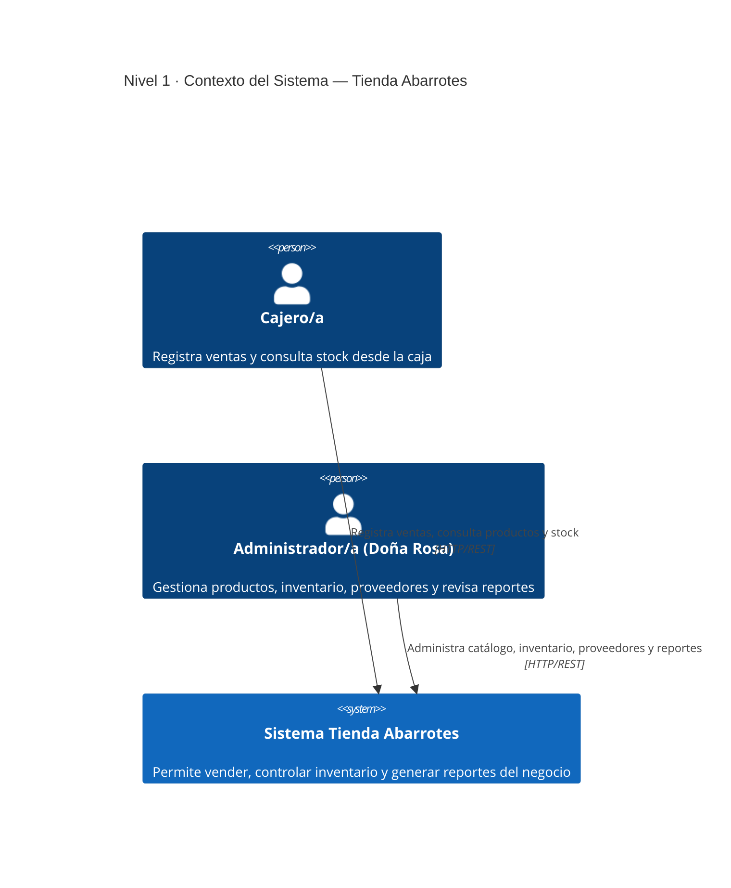
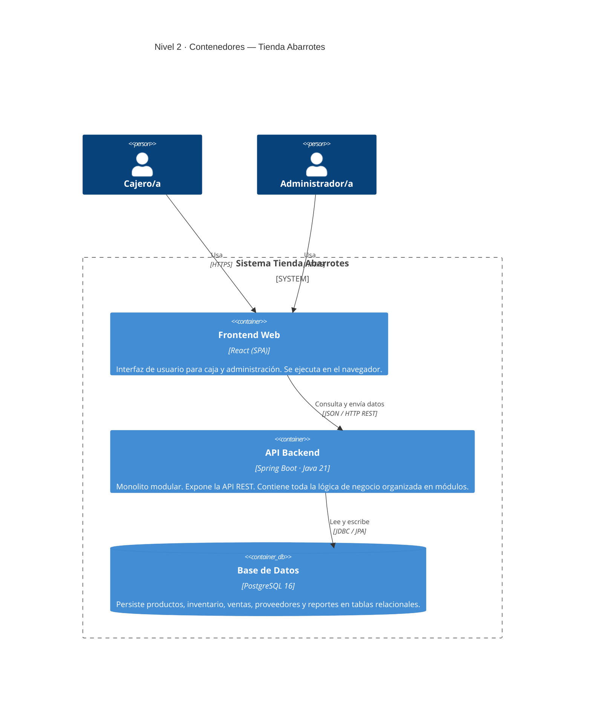
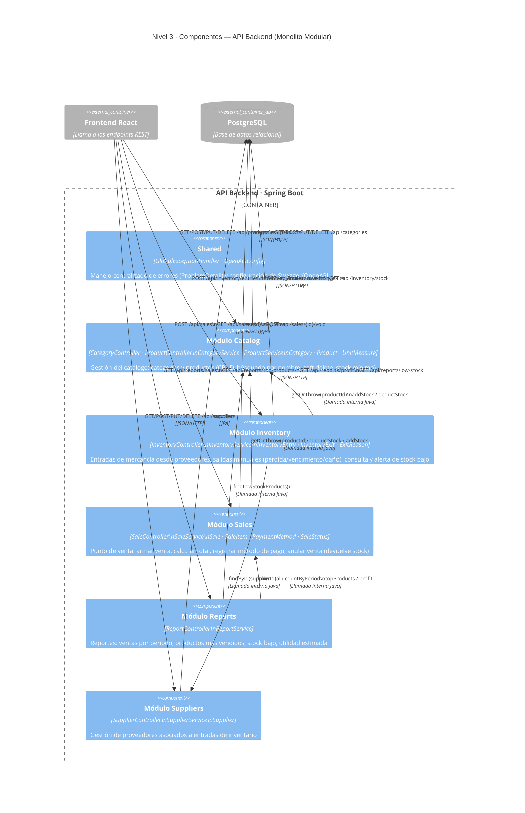

# Enunciado de Proyecto — Sistema de Venta e Inventario para Tienda de Abarrotes

## Contexto

Doña Rosa tiene una tienda de abarrotes de barrio. Hasta ahora lleva las ventas y el inventario en cuadernos y en la memoria: no sabe con certeza cuánto stock le queda de cada producto, se le vencen productos sin darse cuenta, y calcular las ventas del día le toma horas. Necesita un sistema que le permita **vender** y **controlar el inventario** de forma simple, rápida y confiable.

## Objetivo general

Diseñar e implementar un sistema de información que permita gestionar el catálogo de productos, controlar el inventario (entradas y salidas de mercancía) y registrar las ventas de una tienda de abarrotes, generando la información necesaria para la toma de decisiones del negocio.

**Nota importante:** este sistema **no requiere autenticación** en esta etapa. Se asume un único punto de acceso (la caja) sin control de usuarios ni contraseñas. La autenticación podrá agregarse en una fase posterior del proyecto; por ahora el esfuerzo de diseño debe concentrarse en el dominio del negocio (productos, inventario, ventas), no en seguridad.

## Alcance funcional

### 1. Gestión de productos
- Registrar, editar y eliminar (dar de baja) productos.
- Cada producto tiene: código/SKU, nombre, categoría, unidad de medida (unidad, kg, litro, paquete), precio de compra, precio de venta y stock mínimo.
- Agrupar productos por categorías (aseo, granos, lácteos, bebidas, etc.).

### 2. Gestión de inventario
- Registrar entradas de mercancía (compras a proveedores): producto, cantidad, costo, fecha, proveedor.
- Descontar automáticamente el inventario cuando se realiza una venta.
- Registrar salidas manuales por pérdida, vencimiento o daño, con motivo.
- Consultar el stock actual de cualquier producto en tiempo real.
- Alertar (visual o en un listado) cuando un producto llega a su stock mínimo.

### 3. Registro de ventas (punto de venta)
- Armar una venta agregando productos por código o búsqueda por nombre, con cantidad.
- Calcular automáticamente el subtotal, y el total a pagar.
- Registrar el método de pago (efectivo, transferencia) — no se requiere integración real con pasarelas de pago, basta con el registro.
- Generar un comprobante/recibo simple de la venta (en pantalla o imprimible en PDF).
- Permitir anular una venta reciente, devolviendo el stock al inventario.

### 4. Reportes
- Ventas por período (día, semana, mes): total vendido y número de transacciones.
- Productos más vendidos.
- Productos con stock bajo o próximos a agotarse.
- Utilidad estimada (precio de venta − precio de compra) por período.

### 5. Proveedores (opcional / de valor agregado)
- Registrar proveedores y asociarlos a las entradas de inventario.

## Actores del sistema

- **Cajero/a**: registra ventas, consulta productos y stock.
- **Administrador/a (Doña Rosa)**: gestiona productos, categorías, proveedores, revisa reportes y controla entradas/salidas de inventario.

*(Estos son roles funcionales para efectos de diseño de casos de uso y procesos — no implican login/autenticación en esta fase.)*

## Requisitos no funcionales

- El sistema debe responder a las operaciones de venta en menos de 2 segundos (uso en caja, con clientes esperando).
- La información de inventario y ventas debe persistir en una base de datos relacional.
- La interfaz debe ser simple y usable por personal sin formación técnica.
- El sistema debe funcionar en un único punto de venta (no se exige multi-sucursal en esta fase).

## Restricciones tecnológicas sugeridas

- **Frontend:** React
- **Backend:** Spring Boot (API REST)
- **Base de datos:** relacional (PostgreSQL/MySQL)

## Entregables esperados

1. Documento de análisis: historias de usuario o casos de uso, diagrama de procesos (BPMN) del flujo de venta e inventario.
2. Diagrama de clases del dominio, aplicando principios SOLID.
3. Diagrama de despliegue y de componentes de la solución.
4. Repositorio en GitHub con el código fuente y un README de instalación/ejecución.
5. Aplicación funcional que cubra, como mínimo, gestión de productos, inventario y ventas (los reportes y proveedores pueden entregarse como incremento posterior).

## Criterio guía

Prioricen que el flujo de **venta descuente inventario correctamente** y que el **stock nunca quede inconsistente** (por ejemplo, vender más de lo que hay disponible) — ese es el núcleo del negocio. Todo lo demás (reportes, proveedores, comprobantes bonitos) es incremento sobre esa base.

---

## Arquitectura — Monolito Modular

Este sistema se implementa como un **monolito modular**: un único proceso desplegable (Spring Boot) cuyo código interno está organizado en módulos con fronteras explícitas, cada uno dueño de su dominio. Los módulos se comunican entre sí mediante llamadas a servicios Java dentro del mismo proceso, nunca accediendo directamente a las tablas de otro módulo.

> Para una explicación detallada del patrón, ver [MonolitoModular.md](./MonolitoModular.md).

---

## Diagramas C4

El modelo C4 describe la arquitectura en cuatro niveles de zoom. Se documentan aquí los tres primeros.

### Nivel 1 — Contexto del sistema

Muestra quién usa el sistema y con qué sistemas externos interactúa.

---

### Nivel 2 — Contenedores

Muestra los bloques tecnológicos de alto nivel que componen el sistema.

---

### Nivel 3 — Componentes

Muestra los módulos internos del contenedor **API Backend** y cómo se relacionan entre sí.

